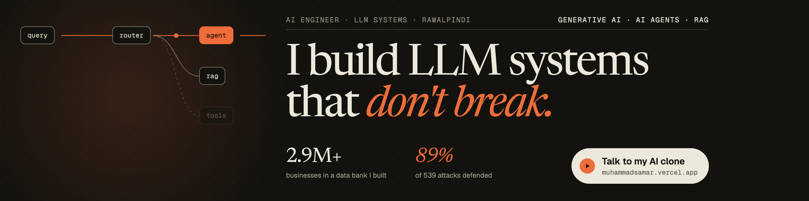

  
  
  
  

## Hi, I'm Samar 👋

I'm an **AI Engineer** who builds production LLM systems: **AI agents**, **advanced RAG**, and the **Python backends** that run them. Then I attack them myself, so real users don't find the holes first.

- 🔭 **Now:** AI Engineer at InterCraft, building agentic workflows on LangGraph + FastAPI
- 🗺️ **Built:** the backend of a geospatial lead platform with a **2.9M+ business** data bank, where repeat searches cost **$0** in paid API calls
- 🛡️ **Broke:** **740+ adversarial tests** against production AI (OWASP LLM Top 10, EU AI Act)
- 🎙️ **Try:** an AI clone of me you can chat with or video-call at [muhammadsamar.vercel.app](https://muhammadsamar.vercel.app)

## Featured work

| Project | What it is | Built with |
|---|---|---|
| 🕌 **[AlimBot](https://github.com/MuhammadSamarShehzad/AlimBot)** · [live](https://alimbot.vercel.app) | Production agentic RAG over Quran, Hadith and fatwas. Relevance gate, semantic cache, automatic LLM failover. **539 red-team tests, 89% defended.** | LangGraph · FastAPI · Qdrant · Redis · AWS Bedrock · Promptfoo |
| 🎙️ **AI Clone** · [live](https://muhammadsamar.vercel.app) | Real-time voice & video agent of me, with a lip-synced avatar and per-visitor rooms. | LiveKit · Deepgram · Claude · Fish Audio · Anam |
| 🗺️ **Geospatial lead platform** | Finds every business in any area. 4-tier entity resolution, H3 coverage tracking, embedding-based keyword matching. | FastAPI · PostgreSQL/PostGIS · Redis · OpenAI |
| 🤖 **Multi-agent coding assistant** | Planner, coder, test-writer and executor agents turn a prompt and a repo into a tested feature on its own branch. | OpenAI · Anthropic · Gemini · Google ADK |

## Toolbox

  

**AI & agents:** LangGraph · LangChain · Google ADK · MCP · OpenAI · Claude · Gemini · AWS Bedrock · Groq · Ollama  
**RAG & data:** Qdrant · Pinecone · FAISS · PostGIS · DuckDB · reranking · RAG Fusion  
**Evals & observability:** Promptfoo · LangSmith · Langfuse · OpenTelemetry · Grafana · Prometheus  
**Voice:** LiveKit · Deepgram · ElevenLabs · Fish Audio

## Writing

📝 [Your AI App Has 8 Unlocked Doors](https://muhammadsamarshehzad.medium.com): the attacks every LLM app must survive, and how to lock each one.

---

  BS Computer Science · CGPA 3.87 · Rawalpindi, Pakistan · Open to AI engineering roles

